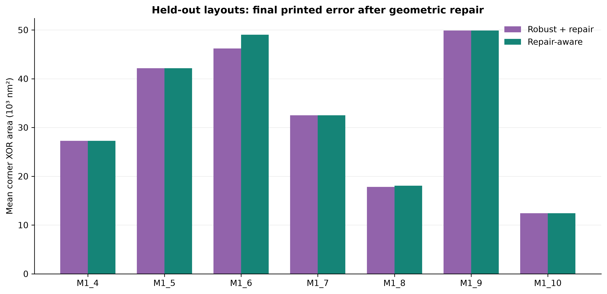

# Repair-Aware Lithography Mask Optimization

A reproducible inverse-lithography experiment on ten public ICCAD 2013 M1 layout clips: how should a binary mask be selected when geometric repair can change both feasibility and printed error?

The implementation combines a differentiable, 24-mode sum-of-coherent-systems (SOCS) simulator with independent double-precision evaluation. It compares selecting the best raw candidate and repairing it afterward against selecting a candidate by its **post-repair** geometry and imaging error. Both use the same optimization trajectory and checkpoint pool.



The bars show mean XOR error area over three optical corners for each held-out layout. Repair-aware selection removes the remaining custom grid defects, at a small imaging-error cost on two layouts. [Full figure](figures/02_held_out_error.png) · [Per-layout data](figures/paired_results.csv)

## Recorded result

The archived experiments optimize on a 512 × 512 grid over a fixed 2048 × 2048 nm tile, with 4 nm pixels. Clips 1–3 form the development split; clips 4–10 form the held-out split. The table averages the three corner errors within each layout, then weights the seven held-out layouts equally.

| Method | Mean corner XOR area (nm²) | Layouts passing both custom grid rules |
|---|---:|---:|
| Target used as mask | 93,520.76 | 7/7 |
| Nominal objective | 33,101.71 | 0/7 |
| Robust objective, raw mask | 31,739.43 | 0/7 |
| Robust objective, then repair | 32,601.14 | 5/7 |
| Repair-aware selection | 33,040.76 | 7/7 |

Repair-aware selection and post-repair selection produce identical masks on five held-out layouts. On clips 6 and 8, repair-aware selection increases error by 2,810.67 and 266.67 nm² respectively while clearing the remaining defect pixels. The mean increase is 439.62 nm², or approximately 1.35% relative to post-repair selection. Grid validity is evaluated using the two morphology checks described in [Methods](docs/METHODS.md#candidate-pool-and-repair).

## Implementation

- [litho_core.py](litho_core.py): public GLP rasterization, PyTorch SOCS forward model, SciPy evaluator, independent geometry checks, and bounded iterative repair.
- [run_experiments.py](run_experiments.py): nominal and robust objectives, shared checkpoints, frozen configuration, candidate selection, and timing accounting.
- [test_physics.py](test_physics.py): forward-model agreement, finite-difference gradients, amplitude scaling, translation, resampling, and geometry fixtures.
- [native_recheck.py](native_recheck.py): 2048-grid evaluation of lifted 512-grid masks. It evaluates existing masks rather than optimizing at 2048 resolution.
- [audit_selection.py](audit_selection.py): comparison of selected candidates' single-precision selection scores against double-precision final scores.

## Run

Use Python 3.12 and run commands from the repository root. The pinned package versions match the archived environment. CPU execution is sufficient; the full optimization experiment is substantially more expensive than the checks below.

```bash
python3 -m venv .venv
source .venv/bin/activate
python -m pip install -r requirements.txt
python setup_openilt.py
python test_physics.py --out results/smoke/physics_checks.json
python audit_selection.py --out results/smoke/selection_audit.json
```

The setup script fetches the public OpenILT source at commit `dabb97c6ca3dfd159362e48273c436444c77353b` and verifies the 21 recorded input hashes. Upstream source and kernels are fetched into the ignored `vendor/` directory.

To rebuild all eight figures from the compact archived evidence, without optimizing again:

```bash
python -m pip install -r requirements-figures.txt
python make_figures.py --out results/regenerated-figures
```

For fresh experiments, input conventions, artifact schemas, and exact commands, see [Reproduction](docs/REPRODUCTION.md). The [Methods](docs/METHODS.md) document explains the objectives and candidate selector; [Results](docs/RESULTS.md) connects the findings to recorded evidence.

## Sources

The recorded experiments use CPU SOCS evaluation with all 24 optical modes. Additional 2048-grid evaluation is available for clips 1 and 4 in [Results](docs/RESULTS.md#native-grid-audit).

Layouts, optical kernels, and the reference forward implementation come from [OpenOPC/OpenILT](https://github.com/OpenOPC/OpenILT/tree/dabb97c6ca3dfd159362e48273c436444c77353b). OpenILT's MIT notice is preserved in [OPENILT_LICENSE](OPENILT_LICENSE). The nominal and robust optimization routes in this repository are transparent project baselines, rather than published OpenILT or MOSAIC benchmark scores.
