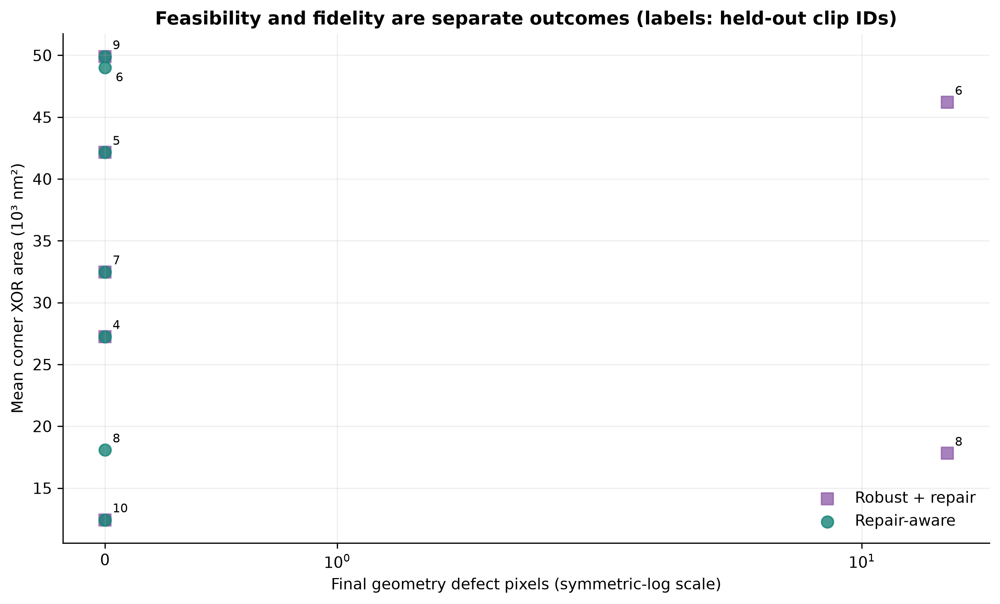
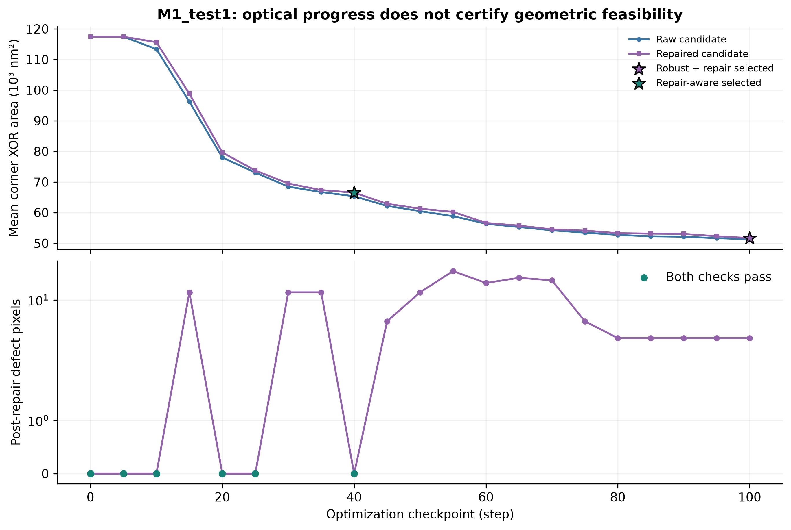
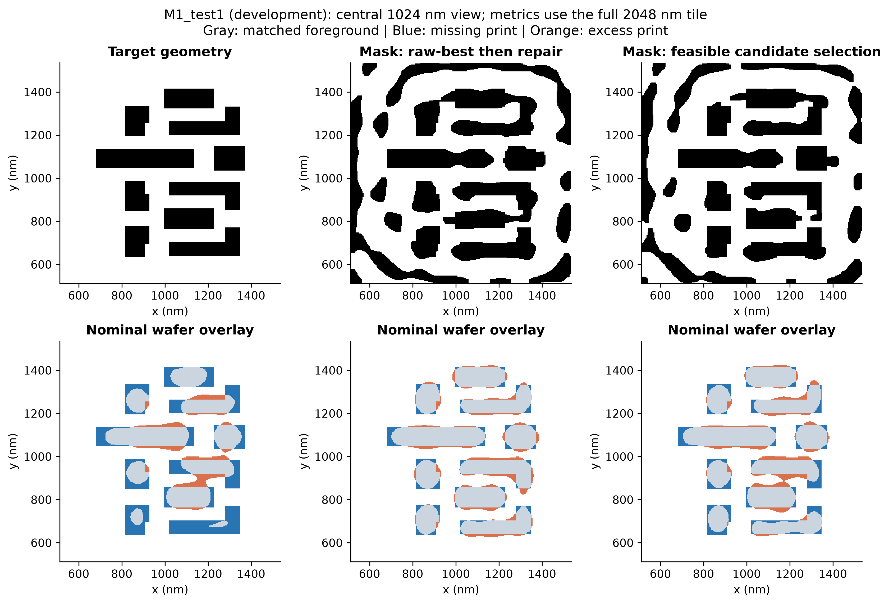
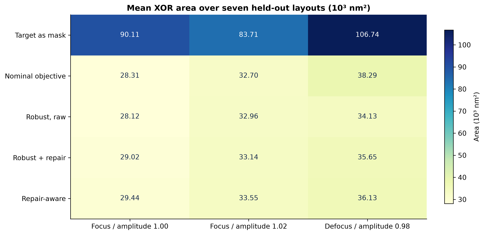
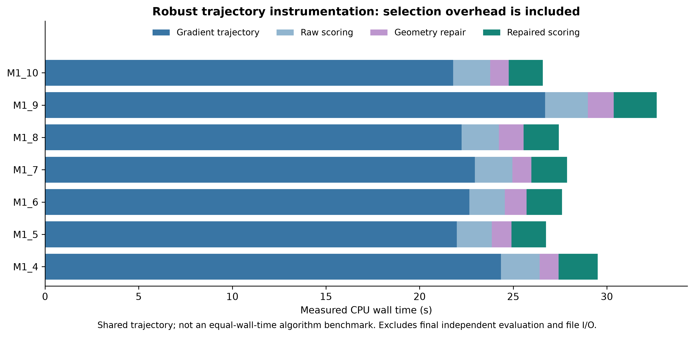
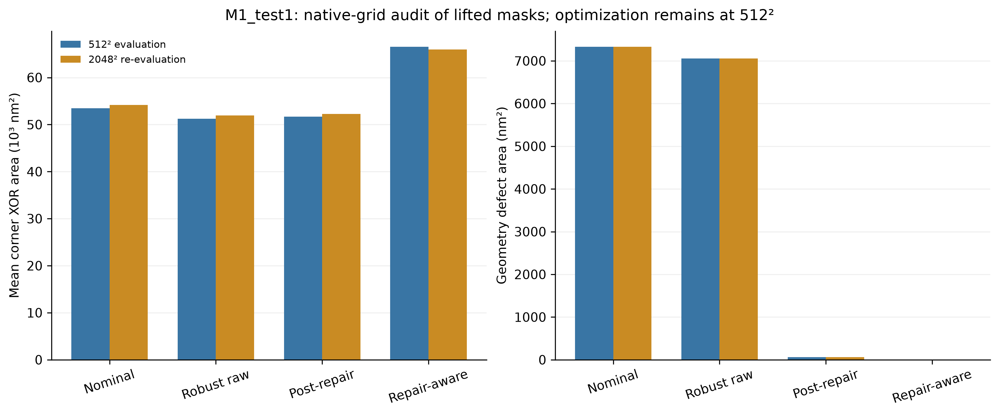
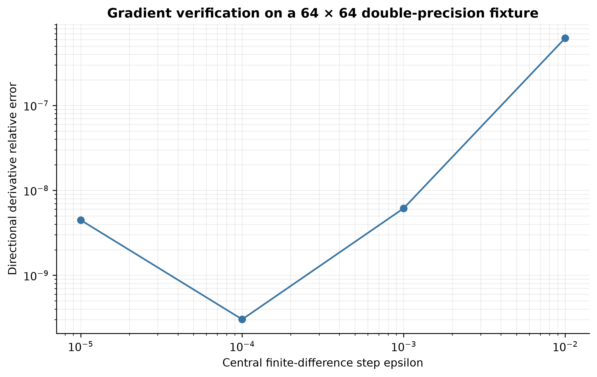

# Results and evidence

[Project overview](../README.md) · [Methods](METHODS.md) · [Reproduction](REPRODUCTION.md)

## Main comparison

The complete recorded protocol contains 100 optimization updates, 21 checkpoints, all 24 optical modes, and three optical corners. The development split is M1_test1–3; the held-out split is M1_test4–10. Each layout contributes one observation per route. Pixel counts convert to area using 16 nm² per coarse-grid pixel.

The seven-layout comparison gives 5/7 grid-valid masks for raw-best-then-repair and 7/7 for repair-aware selection. The latter pays an average 439.62 nm² imaging-error increase. There is no held-out layout on which this selector improves imaging error relative to post-repair selection. Its benefit here is selecting masks that satisfy the two explicit geometry checks.

| Held-out clip | Post-repair step | Repair-aware step | Error increase (nm²) | Post-repair defects (pixels) | Repair-aware defects (pixels) |
|---|---:|---:|---:|---:|---:|
| 4 | 100 | 100 | 0.00 | 0 | 0 |
| 5 | 100 | 100 | 0.00 | 0 | 0 |
| 6 | 100 | 80 | 2,810.67 | 16 | 0 |
| 7 | 100 | 100 | 0.00 | 0 | 0 |
| 8 | 100 | 95 | 266.67 | 16 | 0 |
| 9 | 100 | 100 | 0.00 | 0 | 0 |
| 10 | 100 | 100 | 0.00 | 0 | 0 |

Source: [per-layout paired CSV](../figures/paired_results.csv), [full held-out rows](../results/heldout_results.csv), and [machine-readable summary](../results/metrics_summary.json).

Each point is a held-out layout; labels identify clip IDs where the routes differ. The horizontal axis uses a symmetric-log scale for residual defect pixels. Zero defects mean the custom rules pass, not that a foundry process has qualified the mask.

## Why raw selection and repaired selection can differ

M1_test1 was used as a fixed development illustration. The raw-optimal robust checkpoint still has four opening-defect pixels after repair at 512 resolution. The repair-aware route therefore selects an earlier, feasible checkpoint with larger printed error.

The upper panel follows the same robust trajectory before and after repair. The lower panel independently checks the repaired geometry. The retained [trajectory archive](../results/trajectories.json) and [checkpoint arrays](../results/checkpoints.npz) make the candidate pool inspectable, including candidates that were not selected.

The displayed field is the central 1024 nm region; all reported metrics use the full 2048 nm tile. Gray marks correctly printed foreground, blue marks missing print, and orange marks excess print.

## Process corners and runtime accounting

The matrix reports average XOR area across the seven held-out layouts, separately for nominal focus, high-amplitude focus, and low-amplitude defocus. The high/low labels follow the supplied amplitude convention rather than a calibrated physical dose interval.

The stage bars report optimization, raw scoring, repair, and repaired scoring. The mean recorded robust gradient trajectory takes 23.24 seconds per held-out layout; the complete per-layout pipeline averages 47.98 seconds including other routes, final evaluation, and file work. Shared timings appear in multiple method rows, so summing those rows would double-count work. Shared-desktop wall times and one recorded execution do not establish a controlled algorithm-speed comparison.

## Native-grid audit

The saved 512-grid masks for clips 1 and 4 were lifted by fourfold nearest replication, then evaluated independently on a freshly rasterized 2048-grid target. This changes edge discretization while retaining the original mask optimization.

| Clip | Route | Mean corner XOR area at 2048 (nm²) | Defect pixels at 2048 | Both grid rules pass |
|---|---|---:|---:|---|
| 1 | Robust, then repair | 52,239.67 | 64 | No |
| 1 | Repair-aware | 65,970.33 | 0 | Yes |
| 4 | Robust, then repair | 25,151.33 | 0 | Yes |
| 4 | Repair-aware | 25,151.33 | 0 | Yes |

On clip 1 the feasibility/error tradeoff remains visible. On clip 4 the two routes select the same mask. Two checks do not establish convergence over all layouts. Full tables: [clip 1](../results/native_M1_test1_results.csv), [clip 4](../results/native_M1_test4_results.csv).

The right panel converts geometry defects to area before comparing grids; raw pixel counts would have different physical meaning at 4 nm and 1 nm spacing.

## Numerical consistency

The recorded checks report a maximum SciPy/PyTorch forward discrepancy of approximately 5.0 × 10⁻¹⁶ on the double-precision fixture and a 1.85 × 10⁻⁶ maximum difference from the supplied upstream exact forward implementation on the single-precision layout fixture. The smallest directional-gradient relative error is approximately 3.03 × 10⁻¹⁰.

For all 40 selected optimized masks, all 120 corner error counts match exactly between float32 selection and independent float64 final evaluation. This check concerns the selected masks; it does not prove unchanged ranking of every unselected candidate. See [physics checks](../results/physics_checks.json) and [selection audit](../results/selection_audit.json).

A separate 128-grid Apple MPS probe records a maximum forward difference of about 2.03 × 10⁻⁶ and relative gradient L2 difference of about 1.51 × 10⁻⁶ against CPU. That is a small functionality test. No main-table GPU experiment or NVIDIA acceleration claim follows from it. [Recorded probe](../results/accelerator_probe.json)

## Interpretation limits

Seven held-out layouts support a small layout-level comparison. Their pixels are not millions of independent experiments. No repeated-seed uncertainty estimate, wafer measurement, official EPE checker, shot-count metric, or new-process validation is supplied. The observed result is a concrete selection tradeoff under a fixed public optical model and two finite-grid geometry checks.
